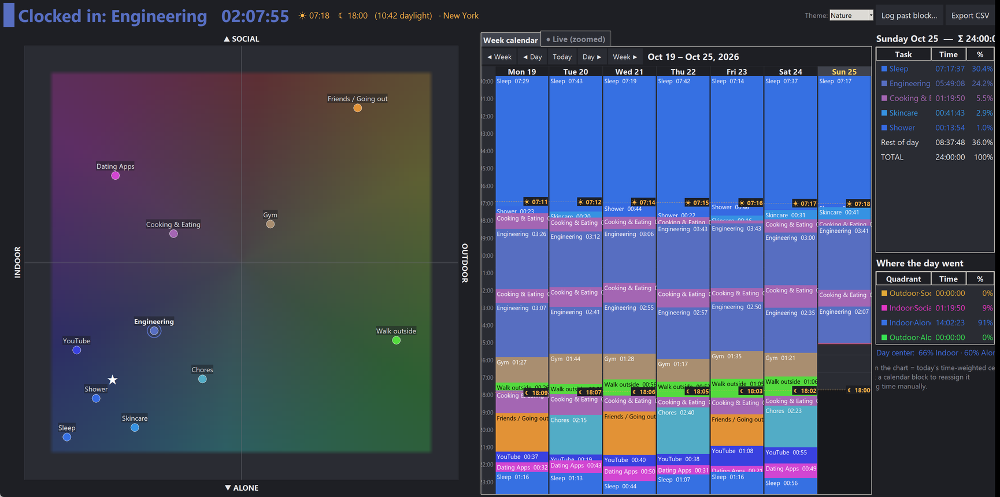
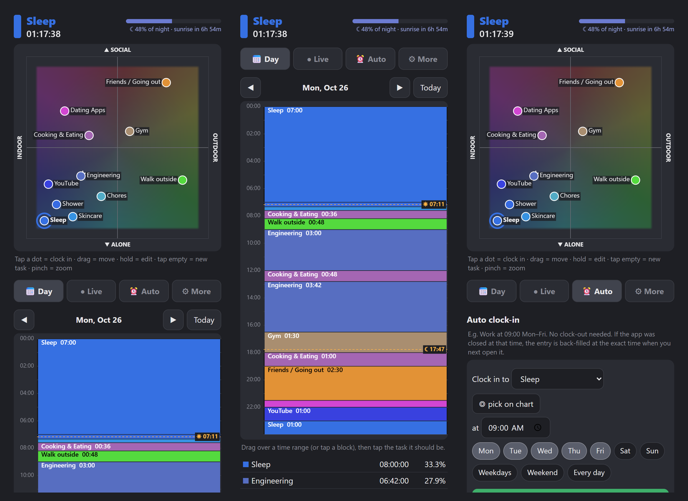

# clockinmetron

"- I don't have time. - Shut up. - We all have 24hr a day"

Clock in to one task at a time, so every day adds up to exactly 24h.
Tasks sit on an **Indoor ↔ Outdoor × Alone ↔ Social** map, and their colors come from where they sit.
That makes the calendar readable at a glance: more orange and green means more outdoor and social time.



## Phone (Android)

**https://fireflaker.github.io/clockinmetron/android/**

Open the link in Chrome, then tap ⋮ → **Install app**. It runs full-screen, works offline and has the same features.
Phone data stays on the phone and is separate from the PC. Use **More → Export JSON** to back it up.



## Run (Windows / desktop)

```powershell
python run.py
```

On first launch this creates a `.venv` and installs `requirements.txt` (numpy, Pillow, astral, tzlocal).
Python 3.10+ with tkinter is required.

## Use

| Action | Effect |
| --- | --- |
| **Click a dot** | Clock in |
| Drag a dot | Move the task (affects new entries only) |
| Click empty space | Add a task there |
| Right-click a dot | Rename / delete |
| Wheel / drag empty space | Zoom / pan; right-click empty space resets |
| **Drag over the calendar** (or click a block) | Pick the task that time range should be on the chart |

On the phone: tap a dot to clock in, drag to move it, hold to edit, tap empty space to add a task, pinch to zoom.
In the Day view, hold then drag to select a range.

- **Week calendar** and a **Live** tab where the current block fills in second by second.
- **Auto clock-in**: for example *Engineering at 09:00 Mon–Fri*. There is no clock-out. If the app was closed at that
  time, the entry is back-filled at the exact time when it next opens.
- Sunrise and sunset markers, plus a **% of day / night** bar. The desktop location is guessed from your timezone; you
  can override it in `data/settings.json` with `"location": "Boston"`. On the phone, set it under More.
- Themes, a quadrant split for each day, and CSV export.

## Data (`data/timeline.db`, SQLite)

```
tags(name, x, y)      -- the chart
log (t, name, x, y)   -- the timeline: "from time t on, doing <name> at (x, y)"
schedules(name, hhmm, days, enabled, last_run)   -- auto clock-in
```

Log rows have no end time, so gaps and overlaps are impossible. Colors are computed live from (x, y)
and the theme, never stored. Editing the chart never rewrites the timeline. The phone app keeps the same structure in
browser storage (`android/app.js`).

Tests: `python -m unittest discover tests`
